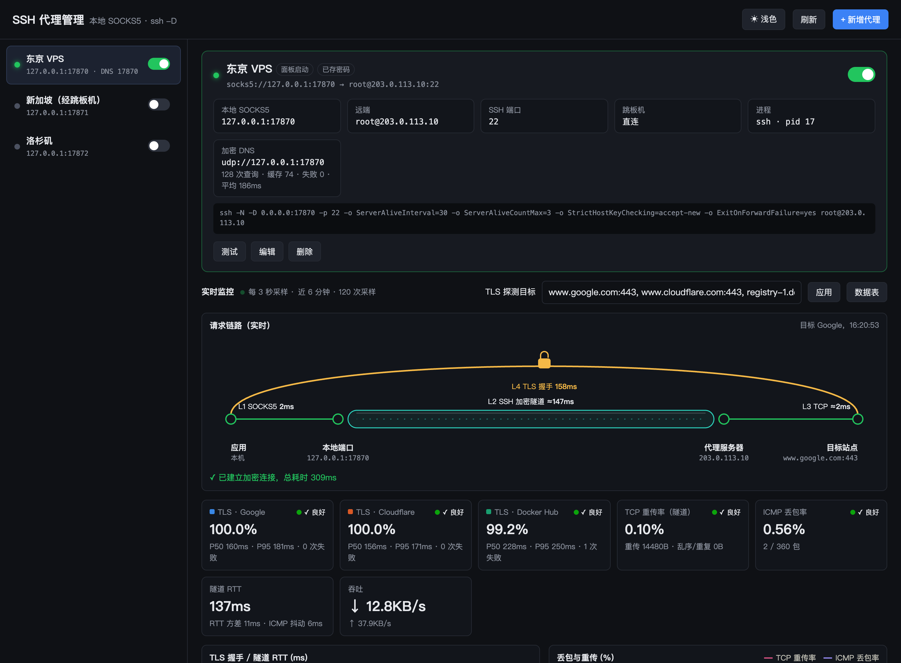
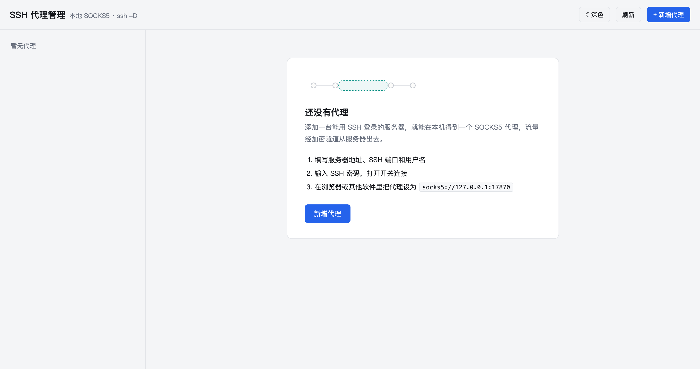
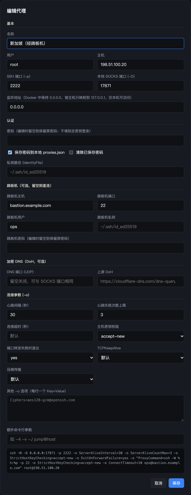
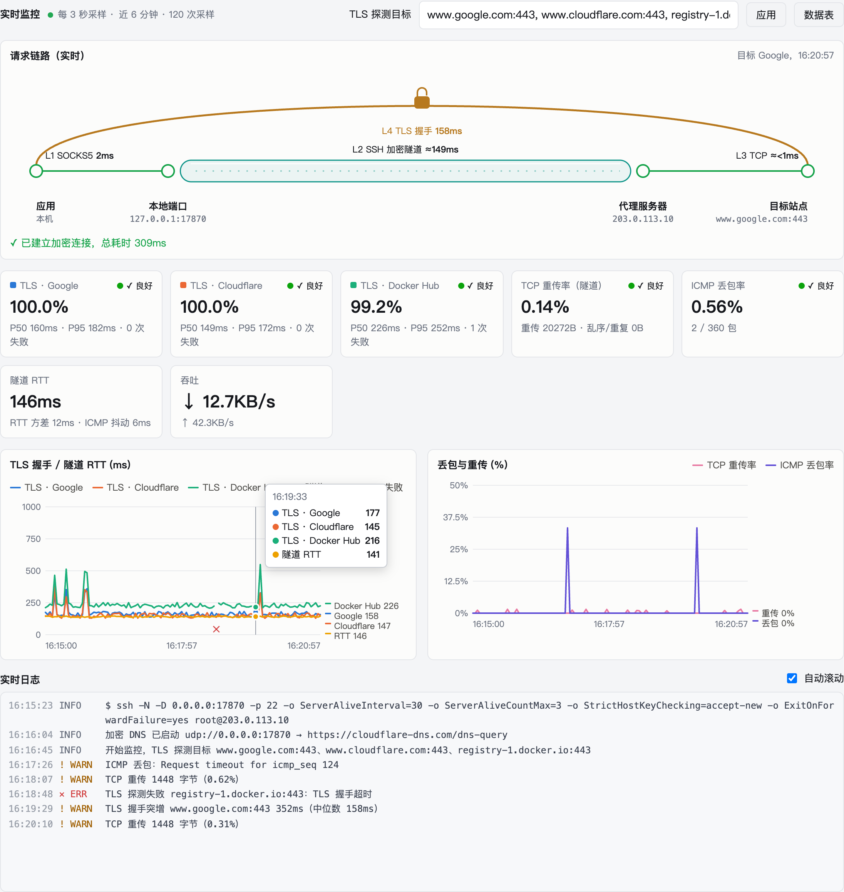

# SSH Proxy Manager

在本机用 `ssh -D` 管理多条 SOCKS5 代理的 Web 面板，带实时监控。



- 多条代理独立配置：SSH 参数、跳板机、密码或私钥登录
- 断线自动重连，容器重启后自动恢复已开启的代理
- 实时监控：TLS 探测（Google / Cloudflare / Docker Hub）、隧道 TCP 重传率与 RTT、ICMP 丢包、吞吐
- 请求链路动画：SOCKS5 → SSH 隧道 → TCP → TLS 逐层展示，失败时停在出错的那一层
- 加密 DNS：本地 UDP DNS 经隧道转发到 DoH（Cloudflare / Google / Quad9）
- 深色 / 浅色主题

## 快速开始

```bash
git clone https://github.com/chentaoyu/ssh-proxy-manager.git
cd ssh-proxy-manager
docker compose up -d
```

打开 http://127.0.0.1:17910 ，首次进入是空列表，点「新增代理」开始。



## 使用说明

### 1. 新增代理



- **基本**：服务器地址、SSH 端口、用户名，以及本机的 SOCKS 端口（Docker 部署需在 `17870-17879` 内，新增时会自动填一个空闲端口）
- **认证**：填密码并勾选「保存密码」，或填私钥路径走密钥登录
- **跳板机**：服务器需要经另一台机器才能登录时填写，跳板机可以有自己的密码
- **加密 DNS**：填一个 UDP 端口即开启，可与 SOCKS 端口相同
- **连接参数**：心跳间隔、连接超时、主机密钥校验等常用 `-o` 参数，其余参数写在「其他 -o 选项」

底部会实时显示最终执行的 `ssh` 命令。

<br clear="right">

### 2. 连接

打开代理右侧的开关即可连接，未保存密码时会先要求输入。连上后：

- 详情里显示进程号和实际执行的命令，点「测试」查看出口 IP
- 开关保持打开的代理断线后会自动重连（5 秒起，最长 5 分钟重试一次）
- 关掉开关才会真正停止，不会被自动拉起

### 3. 在软件里使用代理

```bash
# 验证出口 IP
curl --socks5-hostname 127.0.0.1:17870 https://api.ipify.org

# 当前终端的命令行工具走代理
export ALL_PROXY=socks5h://127.0.0.1:17870

# 只让 git 走代理
git config --global http.proxy socks5h://127.0.0.1:17870
```

浏览器可用系统代理设置或 SwitchyOmega 之类的扩展，类型选 SOCKS5，并开启远程解析 DNS。

### 4. 实时监控

代理运行时，详情页下方会每 3 秒采样一次：



| 指标 | 含义 |
|---|---|
| 请求链路 | 一次真实请求依次经过 SOCKS5、SSH 隧道、TCP 建连、TLS 握手的耗时，L2/L3 为估算值 |
| TLS · 目标站点 | 经代理访问该站点的成功率与握手耗时 P50/P95，探测目标可在「TLS 探测目标」里修改（最多 3 个） |
| TCP 重传率 | SSH 隧道这条 TCP 连接的内核重传统计，反映线路真实丢包 |
| ICMP 丢包率 | 持续 ping 服务器，代理空闲时也能看出线路质量 |
| 隧道 RTT / 吞吐 | 隧道往返时延、抖动和当前上下行速率 |

失败、重传、丢包、握手耗时突增都会写进下方的实时日志。

### 5. 加密 DNS

在代理里填写 DNS 端口后，本机就有一个经隧道转发的加密 DNS：

```bash
dig @127.0.0.1 -p 17870 www.google.com
```

适合支持自定义 DNS 端口的软件；macOS 系统 DNS 只能用 53 端口，系统层面请改用 SOCKS5 远程解析。

## 部署说明

- 面板和代理端口只映射到 `127.0.0.1`，仅本机可访问
- 代理的 SOCKS 端口和 DNS 端口需在 `17870-17879` 内，需要更多端口时修改 `docker-compose.yml`
- 配置与日志保存在 `./data`，**其中包含已保存的 SSH 密码，不要提交到仓库**
- 私钥登录时取消 `docker-compose.yml` 中 `./ssh:/root/.ssh` 的注释，把私钥（权限 600）放进 `./ssh`

国内网络构建时可换镜像源：

```bash
docker compose build --build-arg BASE=docker.m.daocloud.io/library/node:22-bookworm-slim --build-arg APT_MIRROR=mirrors.ustc.edu.cn
```

| 环境变量 | 默认值 | 说明 |
|---|---|---|
| `PORT` | `17900` | 面板端口（容器内） |
| `PANEL_PASSWORD` | 空 | 面板访问密码，留空无需登录 |
| `DEFAULT_BIND` | `0.0.0.0` | 新建代理的监听地址 |
| `DATA_DIR` | `/data` | 配置与日志目录 |

### 不用 Docker 运行

需要 Node.js 22+ 和 OpenSSH 8.4+，无其他依赖：

```bash
node server.js
```

默认在 http://127.0.0.1:17900 ，配置保存在项目目录下的 `proxies.json`。

## 常见问题

**连接成功但访问网站失败，请求链路停在 L3**

服务器的 sshd 禁止了 TCP 转发。在服务器上执行 `sshd -T | grep -i allowtcpforwarding`，如果是 `no`，把 `/etc/ssh/sshd_config` 里的 `AllowTcpForwarding` 改为 `yes` 并重启 sshd。

**本机连不上新增代理的端口**

Docker 只映射了 `17870-17879`，代理的本地端口需在这个范围内。

**Mac 上隧道 RTT 显示 0ms**

Docker Desktop 的虚拟网络会在虚拟机内截断 TCP 连接，容器看不到真实 RTT。Linux 上部署显示正常，请求链路动画里的 L2 用的是 ICMP 往返时间，不受影响。

## 许可证

[MIT](LICENSE)
